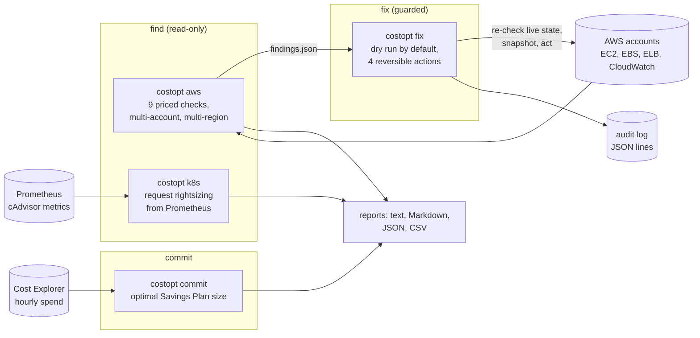
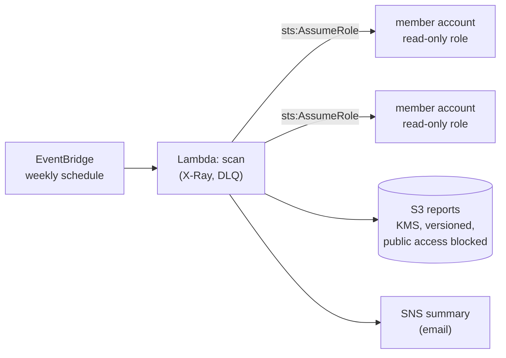

# cloud-cost-optimizer: architecture

Decision details (thresholds, pricing, the safety table) are in [`design.md`](design.md). This page is the system view.

## 1. Context

Cloud cost work has three steps, and most tools stop after the first:
- **find** the waste;
- **fix** what is safe to fix automatically, without anyone fearing the tool;
- **commit** to the remaining steady usage at a discount.

`costopt` covers all three for AWS and Kubernetes: a read-only scanner, a guarded fixer, and a commitment calculator.

## 2. Components

| Module | Responsibility |
|---|---|
| `aws.py` | The checks (`CHECKS`): EBS unattached and gp2, old snapshots, idle EIPs, rightsizing from CloudWatch p95, long-stopped instances, idle load balancers and NAT gateways, untagged spend. Assume-role per account, every region. |
| `k8s.py` | Per-workload p95 CPU and peak memory against requests; detects CPU throttling (usage understates demand) and BestEffort pods |
| `remediate.py` | `fix`: snapshot-then-delete volume, gp2 → gp3, release EIP, delete snapshot. Each re-reads live state first. |
| `commit.py` | Savings Plan sizing: the d-quantile rule, rules of thumb compared, a usage-drop scenario, Cost Explorer input |
| `pricing.py` | Dated us-east-1 price table plus region multipliers: estimates for ranking work, not a bill |
| `report.py` | Text, Markdown, JSON and CSV output |
| `lambda_handler.py` + `deploy/terraform` | Weekly scheduled scan in AWS |

## 3. Safety model (why people let it run)

- **Scanning is read-only by construction.** The IAM policy in Terraform grants only describe/list/get calls, and a test fails if the code calls an API the policy doesn't grant.
- **Fixing:**
  - dry run by default;
  - only reversible or recoverable actions, and volumes are snapshotted before deletion;
  - each resource re-checked at apply time (attached since? tagged `costopt:ignore=true` since? gone?);
  - capped by `--max-actions`;
  - findings from another account refused;
  - every action appended to an audit log.
- **Anything that needs judgement is never automated:** rightsizing (needs a stop/start and memory data), stopping instances, deleting load balancers or NAT gateways. Those become recommendations for a person.

## 4. Deployment

- One central scanner account assumes a read-only role (`deploy/terraform/member-role`) in each member account. No fix runs in Lambda: fixes are a deliberate, human-triggered step.
- Encryption with a dedicated KMS key; a DLQ for failed runs; logs with retention.

## 5. Algorithms worth explaining

| Problem | Approach |
|---|---|
| Rightsizing an instance | p95 of hourly-max CPU over 14 days below 40% → one size down in the same family. p95 of maxima, not the average, so short peaks still count. |
| Rightsizing a Kubernetes request | CPU: p95 usage + headroom, **never cut when throttled** (throttled usage is capped by the limit, so it understates demand). Memory: peak + 20%, because memory isn't compressible. |
| gp2 → gp3 | Saving net of the IOPS and throughput gp3 needs to match the gp2 volume's baseline |
| Savings Plan size | Convex piecewise-linear cost in the covered level L; the optimum is the d-quantile of hourly spend (newsvendor problem); property-tested against brute force |

## 6. Testing

| Level | What |
|---|---|
| Unit (moto, 87 tests) | Every check on seeded resources; age guards and the ignore tag; fixer re-checks, caps and account guard; IAM policy covers every API call; Kubernetes rules (throttling, BestEffort); commitment optimum vs brute force on 40 random histories, Cost Explorer paging with botocore's Stubber |
| Demo in CI | A moto server seeded with typical waste: scan, fix, rescan. It fails if the fix doesn't reduce the findings. The sample commitment report goes to the job summary. |
| Terraform | validate plus Checkov on the deployment |

## 7. Limits and next steps

- Prices are estimates. Plug in the Pricing API or the CUR for exact numbers.
- Existing commitments: analyse the utilisation of plans already owned (Cost Explorer `GetSavingsPlansUtilization`) to catch over-commitment.
- S3 storage classes, RDS, cross-AZ and NAT data transfer, and Spot/Graviton candidates. Each is one more function in `CHECKS` plus its IAM actions; the policy test keeps the two in sync.
